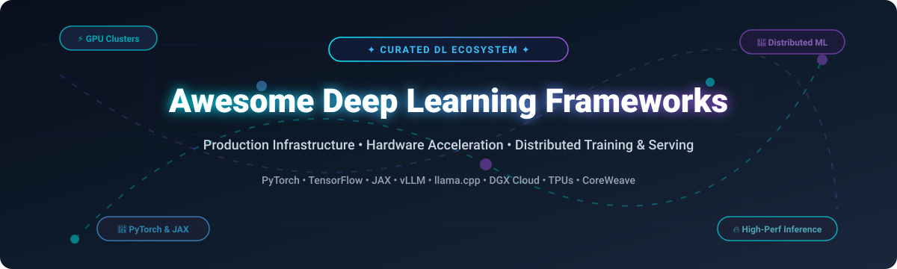
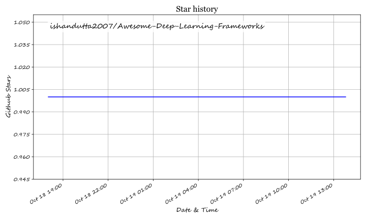

# Awesome-Deep-Learning-Frameworks 🚀

  

  
  
  
  
  
  
  

## 🌐 Top Deep Learning Frameworks & AI Infrastructure Ecosystem

**A Curated Directory of SaaS AI Cloud Platforms & Open-Source Deep Learning Frameworks**  
*Comprehensive guide to hardware acceleration, LLM serving, distributed training, neural network libraries, and high-performance production infrastructure.*

**Last updated: October 2026** 📅

---

### 📖 Overview

This repository tracks notable **SaaS platforms** and **open-source projects** across the **Deep Learning Frameworks** ecosystem. These tools provide the high-performance compute, cluster orchestration, compiler optimizations, and core neural network libraries required to build, train, fine-tune, and serve models at scale—from on-demand GPU clouds that provision H100 clusters by the second to foundational frameworks that define dynamic computation graphs.

* **Top Frameworks & Runtimes**: PyTorch, TensorFlow, JAX, Hugging Face Transformers, vLLM, llama.cpp, Triton, Keras.
* **Top AI Cloud & Hardware Providers**: NVIDIA DGX Cloud, Google Cloud TPU, AWS Inferentia, CoreWeave, Lambda Labs, RunPod.
* **Open-Source Tooling**: Distributed training runtimes (DeepSpeed), framework abstractions (PyTorch Lightning), cross-platform model representations (ONNX), and specialized LLM inference engines.

Contributions welcome! Open a PR to add or update entries. Please keep descriptions factual and benchmark-driven.

---

## 📑 Table of Contents

- [📊 Sector Overview & Market Dynamics](#-sector-overview--market-dynamics)
- [☁️ SaaS/Hosted Platforms](#-saashosted-platforms)
- [🔓 Open-Source GitHub Projects](#-open-source-github-projects)
- [🤝 How to Contribute](#-how-to-contribute)
- [💖 Support & Sponsorship](#-support--sponsorship)
- [📈 Star History](#-star-history)
- [⚠️ Disclaimer](#️-disclaimer)

---

## 📊 Sector Overview & Market Dynamics

The global AI Infrastructure and Cloud AI market is experiencing an unprecedented capital expansion, projected to reach between **$114 billion and $170 billion in 2026** (with total hyperscale AI hardware spending and CapEx exceeding $1 trillion according to Gartner). The sector exhibits **moderate-to-high concentration** characterized by "winner-take-most" economies of scale at the foundational hardware and accelerator layer (dominated by NVIDIA and the hyperscaler cloud duopoly/oligopoly), while maintaining **moderate fragmentation** across the developer layer, neocloud GPU providers, and specialized distributed inference frameworks.

---

## ☁️ SaaS/Hosted Platforms

| Product | Company Valuation / Market Cap | Starting Pricing | Free Tier / Trial Limits | Description & Best For |
| :--- | :--- | :--- | :--- | :--- |
| **NVIDIA DGX Cloud** 🏢 | ~$5.5 Trillion (NVIDIA) | Starts at $36,999/instance/month (8x A100/H100 GPU node) | No free tier or trial for dedicated DGX Cloud supercomputers; free developer prototyping access available for NVIDIA NIM APIs via NVIDIA Developer Program | **Managed AI training infrastructure** on NVIDIA's DGX systems. Dedicated GPU clusters with NVIDIA AI Enterprise software. **Best for**: enterprises wanting NVIDIA-validated infrastructure without managing hardware. |
| **Google Cloud TPU** 🧠 | ~$4.2 Trillion (Alphabet) | Starts at $1.20/chip-hour (TPU v5e on-demand); Spot from ~$0.60/chip-hour | 90-day free trial with $300 in Google Cloud credits applicable across GCP services including TPUs (no permanent free tier for hardware accelerators) | **Google's custom ASIC accelerators** optimized for TensorFlow and JAX workloads. **Best for**: teams training large transformer models on GCP leveraging XLA compilation. |
| **AWS Inferentia** ⚡ | ~$2.7 Trillion (Amazon) | Starts at $0.228/hour (`inf1.xlarge`); $0.758/hour (`inf2.xlarge`) on-demand | No dedicated free tier for Inf1/Inf2; compatible with new-account standard promotional credits (e.g., $200 sign-up credits) or 2-month Amazon SageMaker Free Tier limits | **AWS's custom inference chips** for cost-optimized model serving (Inferentia2 for LLM low latency). **Best for**: production inference on AWS where cost-per-inference matters. |
| **CoreWeave** 🚀 | ~$35 Billion | Starts at $0.78/GPU/hour (lower tiers/spot); $6.16/GPU/hour (H100 on-demand) | No permanent free tier or public self-serve trial; occasional promotional credits granted via sales or startup applications | **The AI Hyperscaler**—purpose-built cloud for accelerated computing with zero data egress fees. **Best for**: large-scale training clusters with predictable networking costs. |
| **Lambda Labs** 💻 | ~$14.5 Billion | Starts at $0.79/GPU/hour (on-demand); reserved instances available | No permanent free tier; one-time promotional sign-up trial credits (~$10) offered for eligible new accounts | **GPU cloud with on-demand and reserved instances** featuring one-click Jupyter notebooks and per-minute billing. **Best for**: teams wanting transparent GPU pricing and fast NVIDIA hardware access. |
| **RunPod** ☁️ | ~$1.0 Billion | Starts at $0.27/hour (Community Cloud) / $0.44/hour (Secure Cloud); per-second billing | No permanent free tier; $10 promotional sign-up trial credit for new accounts to test pods/serverless endpoints | **GPU cloud with serverless endpoints and pods**. Instant deployment and zero egress charges. **Best for**: developers wanting affordable GPU access without long-term commitments. |

---

## 🔓 Open-Source GitHub Projects

Sorted by GitHub_Stars (descending):

1. ### **TensorFlow**  🌟
   **An end-to-end open-source machine learning platform** (Apache-2.0).  
   * **Key Strengths**: Industrial-grade deployment tooling (TensorFlow Serving, TensorFlow Lite for mobile/edge, TensorFlow.js), mature production pipelines, and multi-language support (Python, C++, Java).  
   * **Best For**: Large-scale industrial production deployments and edge/embedded ML applications.

2. ### **Hugging Face Transformers**  🤗
   **State-of-the-art Machine Learning for PyTorch, TensorFlow, and JAX** (Apache-2.0).  
   * **Key Strengths**: The gold standard model hub with over 1M+ checkpoints for text, vision, audio, and multimodal tasks; unified APIs for fine-tuning and inference.  
   * **Best For**: Rapidly building, fine-tuning, and sharing state-of-the-art transformer architectures.

3. ### **llama.cpp**  🦙
   **LLM inference in C/C++ with zero dependencies and cross-platform acceleration** (MIT).  
   * **Key Strengths**: Extremely high-efficiency local inference on Apple Silicon, x86 CPU AVX2/AVX512, and NVIDIA/AMD GPUs via 2-bit to 8-bit integer quantization (GGUF).  
   * **Best For**: On-device and self-hosted local LLM serving with minimal memory footprint.

4. ### **PyTorch**  🔥
   **Tensors and dynamic neural networks in Python with strong GPU acceleration** (BSD-3-Clause).  
   * **Key Strengths**: Dynamic computation graphs (eager mode by default), native Pythonic debugging, PyTorch 2.x `torch.compile` graph optimization, and the dominant framework for modern AI research papers.  
   * **Best For**: Frontier AI research, rapid prototyping, and scalable deep learning model development.

5. ### **vLLM**  ⚡
   **High-throughput and memory-efficient LLM serving engine** (Apache-2.0).  
   * **Key Strengths**: Pioneered PagedAttention for optimal KV-cache memory management; continuous batching, chunked prefill, and speculative decoding yielding 2x–4x throughput improvements over naive serving.  
   * **Best For**: High-throughput production LLM serving, enterprise inference clusters, and API backends.

6. ### **Keras**  🎯
   **Multi-backend deep learning framework for TensorFlow, PyTorch, and JAX** (Apache-2.0).  
   * **Key Strengths**: Simple, elegant, modular API that allows seamless switching between PyTorch, JAX, and TensorFlow backends without altering model architecture code.  
   * **Best For**: Rapid experimentation, educational workflows, and cross-framework library authoring.

7. ### **DeepSpeed**  🚄
   **Deep learning optimization library for extreme-scale distributed training and inference** (Apache-2.0).  
   * **Key Strengths**: ZeRO (Zero Redundancy Optimizer) stages 1, 2, and 3; CPU/NVMe memory offloading, pipeline parallelism, and low-latency inference optimizations.  
   * **Best For**: Training and fine-tuning multi-billion parameter foundation models on hardware-constrained GPU clusters.

8. ### **JAX**  🧮
   **Composable transformations of Python+NumPy programs: differentiate, vectorize, JIT to GPU/TPU** (Apache-2.0).  
   * **Key Strengths**: Functional programming paradigm with first-class primitives (`jit`, `grad`, `vmap`, `pmap`) compiled directly to XLA for near-linear multi-accelerator scaling.  
   * **Best For**: Cutting-edge research, scientific computing, reinforcement learning, and high-performance TPU/GPU modeling.

9. ### **PyTorch Lightning**  ⚡
   **Lightweight PyTorch wrapper and structured training orchestration** (Apache-2.0).  
   * **Key Strengths**: Separates research science from engineering boilerplate; automatic multi-GPU/TPU distributed handling, checkpointing, mixed precision, and telemetry hooks.  
   * **Best For**: Teams wanting the raw flexibility of PyTorch coupled with clean, reproducible engineering structures.

10. ### **PaddlePaddle**  🛶
    **PArallel Distributed Deep LEarning platform by Baidu** (Apache-2.0).  
    * **Key Strengths**: Comprehensive end-to-end industrial ecosystem featuring rich pre-trained model repositories (PaddleOCR, PaddleDetection, PaddleNLP) and optimized deployment kits.  
    * **Best For**: Enterprise computer vision, document intelligence, and Chinese NLP applications.

11. ### **ONNX (Open Neural Network Exchange)**  🔄
    **Open standard format to represent and exchange machine learning models** (Apache-2.0).  
    * **Key Strengths**: Framework-agnostic model interchange format supported by PyTorch, TensorFlow, TensorRT, and OpenVINO; enables cross-platform deployment portability.  
    * **Best For**: Interoperability between training frameworks and target hardware runtimes (ONNX Runtime, mobile, edge devices).

12. ### **Apache MXNet**  🏛️
    **Scalable deep learning framework supporting multi-language bindings** (Apache-2.0).  
    * **Key Strengths**: Built for multi-GPU efficiency and multi-language support (Python, R, Julia, Go, C++, Scala); historically adopted by AWS for scalable model deployment.  
    * **Best For**: Legacy multi-language distributed systems and academic exploration.

13. ### **Triton (OpenAI)**  🔱
    **Programming language and compiler for writing highly efficient custom deep learning kernels** (MIT).  
    * **Key Strengths**: Allows Python developers to author peak-performance GPU kernels with productivity significantly higher than CUDA; native compiler engine powering PyTorch 2.0 `torch.compile`.  
    * **Best For**: ML researchers and engineers building custom attention algorithms, novel activation kernels, and custom hardware accelerators.

14. ### **Flax**  🌿
    **Neural network library and ecosystem designed for JAX** (Apache-2.0).  
    * **Key Strengths**: Modular, functional neural network layer built by Google DeepMind and Google Research; leverages JAX's full transformation suite with clean state management.  
    * **Best For**: JAX practitioners training vision transformers, diffusion models, and LLMs on TPU pods.

---

### 💡 Framework Selection Guide

| Need / Use-Case | Recommended Stack | Rationale |
| :--- | :--- | :--- |
| **Frontier Research & New Papers** | **PyTorch** + **Triton** | Industry default; dynamic computational graph for debugging and custom kernel execution. |
| **High-Throughput LLM Production Serving** | **vLLM** or **llama.cpp** | PagedAttention batching for cloud GPUs or GGUF quantization for local/edge hardware. |
| **Max-Performance TPU Clusters** | **JAX** + **Flax** | Native functional compilation to XLA with near-linear multi-node scaling. |
| **Cross-Platform & Multi-Backend Dev** | **Keras** + **ONNX** | Author models once; execute across PyTorch, JAX, TensorFlow, or deploy via ONNX Runtime. |
| **Extreme Large-Model Fine-Tuning** | **DeepSpeed** + **Transformers** | ZeRO memory offload allows multi-billion parameter models to fit on consumer/prosumer GPUs. |

---

## 🤝 How to Contribute

Contributions are welcome and appreciated! Here's how to contribute:

1. 🍴 Fork the repository.
2. 🌿 Create your feature branch (`git checkout -b feature/add-new-framework`).
3. 📝 Add or update entries in `README.md` (keep descriptions objective, link directly to GitHub repos or platforms, and ensure badges follow existing styling).
4. 🚀 Commit your changes (`git commit -m 'Add framework XYZ'`).
5. 📬 Open a Pull Request with a clear description of the addition.

---

## 💖 Support & Sponsorship

If this curated deep learning ecosystem guide helps your projects, workflows, or research:

* ⭐ **Star the repository** to boost discoverability for fellow ML engineers.
* 🍴 **Fork the repository** to customize your personal tooling stack.
* 📢 **Share with your colleagues** on Discord, LinkedIn, or Twitter/X.
* ☕ **Support future maintenance and open research** by buying a coffee via the [GitHub Sponsor Dashboard](https://github.com/sponsors/ishandutta2007)!

---

## 📈 Star History

---

## ⚠️ Disclaimer

- This is a **community-curated** list — not exhaustive and not a commercial endorsement.
- Deep learning frameworks and cloud infrastructure providers must be evaluated for **hardware compatibility**, **ecosystem maturity**, **network interconnect (InfiniBand/RoCE)**, and **total cost of ownership (TCO)**—not just isolated theoretical benchmarks.
- Pricing, API limits, and GPU availability fluctuate regularly; always verify latest terms directly with respective providers.

---

  <b>Built for ML engineers, AI researchers, and systems architects building scalable deep learning solutions.</b> 
  <i>Let's make Deep Learning Frameworks open, data-driven, and hardware-aware.</i> 🚀

## ⭐ Star History

<a href="https://star-history.com/#ishandutta2007/Awesome-Deep-Learning-Frameworks&Timeline" align="center">
  <picture>
    <source media="(prefers-color-scheme: dark)" srcset="assets/ishandutta2007_Awesome-Deep-Learning-Frameworks_growth.svg">
    
  </picture>
</a>
